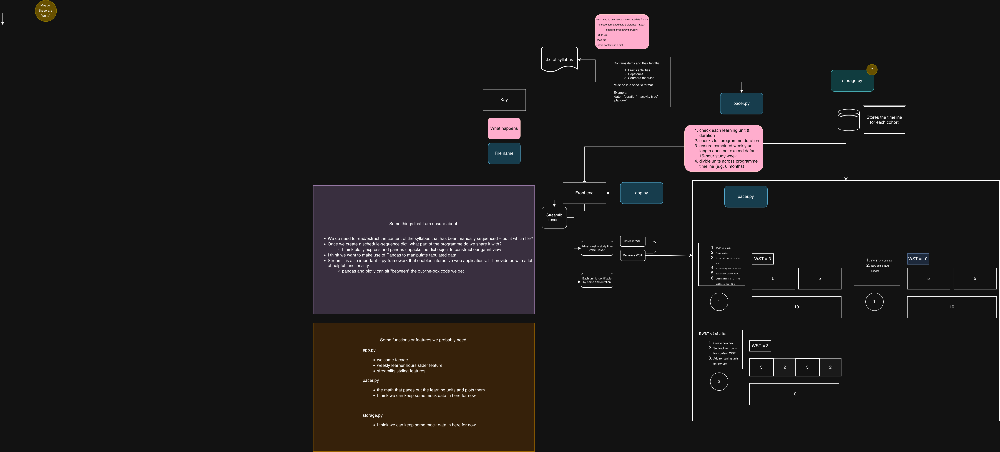

# Pathway Visualizer

A Streamlit prototype that turns a curriculum into a learner timeline,
flags gaps, and generates content to fill them using Gemini.

## Status
Paused. Much of this was AI-generated, and I stopped because I didn't
feel good about building it that way.
I'm parking it here as a record of the idea and what I learned.

## Files
- `curriculum_architecture_engine.py`: the original single-file version (one-shotted by Gemini)
- `app.py`: a later, more modular attempt

## Architecture

## What it was meant to do
- Show a learner's pathway (components, activities, assessments) on a
  timeline, using pandas and Plotly
- Toggle weekly learning load (e.g. 5 vs 30 hours), re-pace activities
  and flag overloaded weeks
- Analyse the curriculum for gaps
- Generate one-hour lesson plans for subject matter experts to fill those gaps
- Generate assessments by prompting an LLM with a template
- Read registries of activities and assessments from Google Sheets in
  Google Drive and build them into the curriculum based on observed skills
- Provide a learner view and an admin view

## What I'd do differently
- Write the core logic myself rather than one-shotting it
- Start smaller: the visualiser first, generation features later